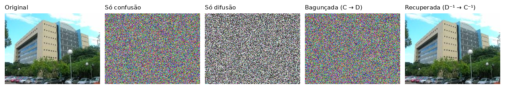

# Bagunceitor - Confusão e Difusão em Imagens

Trabalho Prático 1 de Programação de Baixo Nível

O programa bagunça uma imagem com uma etapa de **confusão** (troca o valor dos bytes) e uma de **difusão** (troca as posições dos pixels), as duas controladas por uma chave de texto. Depois desfaz tudo na ordem contrária e recupera a imagem byte a byte.



##Compilar

```
mingw32-make      #Windows (MinGW)
make              #Linux / macOS
```


##Usar

```
bagunceitor <imagem> <chave>
```
Demo completa. Gera `so_confusao.png`, `so_difusao.png`, `baguncada.png` e `recuperada.png`, mostra os primeiros bytes na memória em cada etapa e compara a recuperada com a original byte a byte (também relendo `baguncada.png` do disco).

```
bagunceitor -b <imagem> <chave> [saida.png]          #só bagunça
bagunceitor -r <baguncada.png> <chave> [saida.png]   #só recupera
```

A imagem bagunçada **precisa** ser salva em PNG. Um JPG perde informação e a recuperação deixa de ser exata.

##Arquivos

| Arquivo | O que tem |
|---|---|
| `main.c` | Linha de comando, orquestração (C → D e D⁻¹ → C⁻¹) e a demo |
| `imagem.c/.h` | Structs `Pixel`/`Img`, leitura e gravação (stb), cópia e comparação |
| `chave.c/.h` | Gerador pseudoaleatório (FNV-1a + xorshift32) a partir da chave |
| `confusao.c` | Confusão: S-box por chave + soma de fluxo + encadeamento XOR |
| `difusao.c` | Difusão: rotação dos canais RGB + permutação de pixels (Fisher–Yates) |
| `bagunca.h` | Protótipos das quatro operações |
| `include/` | Bibliotecas stb_image e stb_image_write (do código base) |

##Regras

**Confusão (por byte):** `c[i] = S[(v[i] + k[i]) mod 256] XOR c[i-1]`
**Inversa:** `v[i] = (S⁻¹[c[i] XOR c[i-1]] − k[i]) mod 256`

**Difusão:**
1. Cada pixel tem seus canais girados 0, 1 ou 2 vezes (R,G,B → G,B,R).
2. Os pixels são levados para novas posições por uma permutação `perm` (Fisher–Yates): `saida[perm[i]] = entrada[i]`.

**Inversa:** `saida[i] = entrada[perm[i]]` e depois gira os canais no sentido contrário.
